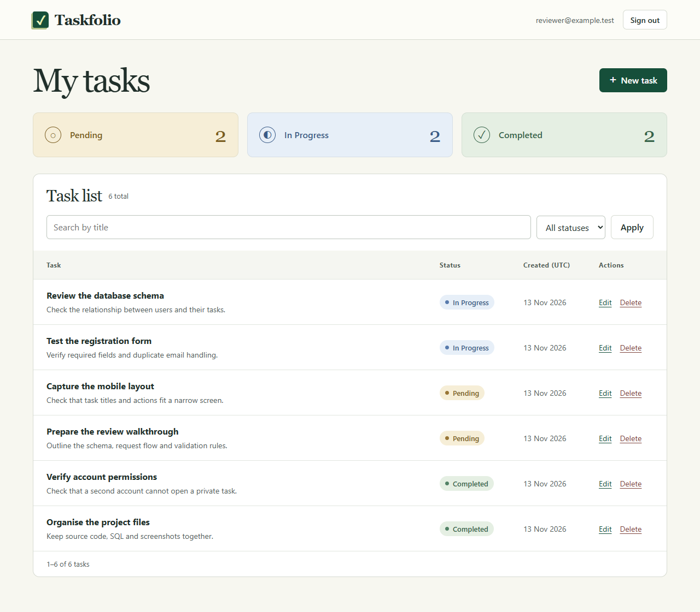

# Taskfolio · RTIH Task Tracker

Taskfolio is a PHP and MySQL task tracker built for the RTIH IT internship assignment. It completes all three levels. Each registered user has a private dashboard where they can add tasks, track progress and search their own list.



Click a task’s status badge to open the [status popup](screenshots/05-change-status.png). Choose **Pending**, **In Progress** or **Completed** to save immediately. The dashboard updates its counts and keeps your current filters. Cancel or press Escape to close the popup.

## Assignment deliverables

| Level | Implementation |
| --- | --- |
| 1 · Task management | Create, view, edit and delete tasks. Deletion requires confirmation. |
| 2 · Search and validation | Change status, search titles and combine filters. Both PHP and the browser validate form input. |
| 3 · Authentication and authorization | Register and sign in. The server checks task ownership, verifies CSRF tokens, binds query parameters and escapes displayed text. |

[Completion note and limitations](COMPLETION.md) · [Test cases and results](TESTING.md) · [Screenshots](screenshots/) · [Database schema](database.sql)

## Run locally

**Requirements.** PHP 8.1 or later with `pdo_mysql`, `mbstring` and sessions enabled, plus MySQL 8.0. The project was tested with PHP 8.2.29 and MySQL 8.0.43. It uses server-rendered HTML and local CSS. No package installation or asset build is required once PHP and MySQL are available.

1. Clone the repository and open its directory. If using a downloaded ZIP, extract it and open the folder containing `database.sql`.

   ```sh
   git clone https://github.com/vyshnav17/rtih-task-tracker.git
   cd rtih-task-tracker
   ```

   Start MySQL. Confirm PHP is available using `php -v`. Run `php -m` and check for `pdo_mysql` and `mbstring`. If necessary, enable the corresponding extensions in the file reported by `php --ini`.
2. Open a MySQL client as a local schema administrator. From the project directory, run `mysql -u YOUR_ADMIN_USER -p`, enter the password at the prompt, then run the command below inside MySQL. It creates the `rtih_task_tracker` database and its tables. Import once into a fresh database. In MySQL Workbench you can instead open and execute `database.sql`.

   ```sql
   SOURCE database.sql
   ```

3. Use a local application database account with SELECT, INSERT, UPDATE and DELETE on `rtih_task_tracker.*`. If you need to create one, replace the examples below in your local MySQL client. Match the account host to the address used by PHP.

   ```sql
   CREATE USER 'taskfolio_app'@'127.0.0.1' IDENTIFIED BY '<choose a local password>';
   GRANT SELECT, INSERT, UPDATE, DELETE ON rtih_task_tracker.*
       TO 'taskfolio_app'@'127.0.0.1';
   ```

4. Set the account details in the terminal that will run PHP. In PowerShell, use the following commands. The password prompt hides what you type.

   ```powershell
   $env:DB_USER = Read-Host 'MySQL application user'
   $localPassword = Read-Host 'MySQL password' -AsSecureString
   $env:DB_PASSWORD = [System.Net.NetworkCredential]::new('', $localPassword).Password
   php -S 127.0.0.1:8000 -t public
   ```

   In Bash, use the same environment variables.

   ```bash
   read -r -p 'MySQL application user: ' DB_USER
   read -r -s -p 'MySQL password: ' DB_PASSWORD
   echo
   export DB_USER DB_PASSWORD
   php -S 127.0.0.1:8000 -t public
   ```

   The default connection uses host `127.0.0.1`, port `3306` and database `rtih_task_tracker`. Override `DB_HOST`, `DB_PORT` or `DB_NAME` in the same terminal if needed. Serve the `public` directory as the document root.

5. Open [Taskfolio on localhost](http://127.0.0.1:8000), choose **Create an account**, then sign in with the same email and password. Registration supplies the test login. The SQL file contains only the schema. The example tasks in the screenshots were created through the app.

If registration shows “The workspace is temporarily unavailable”, verify that MySQL is running, the schema import succeeded, the PHP extensions are enabled and the account has the permissions from step 3. Restart the PHP server after changing its environment.

## Code walkthrough

| File | What to look for |
| --- | --- |
| `database.sql` | The two tables, the unique email constraint and the task ownership relationship. |
| `public/index.php` | Routes, login checks, token checks, validation, queries and redirects. |
| `app/bootstrap.php` | Session settings, PDO configuration, prepared query helper and validation helpers. |
| `app/layout.php` | Authentication, add/edit and delete-confirmation forms. |
| `app/dashboard.php` | Status counts, filters, task rows and pagination links. |
| `public/style.css` | Responsive controls, status indicators and small-screen layout. |

**Who can access a task?** Each registered account has one role, task owner. At sign-in, PHP verifies the password hash and saves the user's database ID in a regenerated session. A new task gets that ID from the session. Listing, counts, lookups, edits and deletes all include the session user's ID in the SQL. A guessed task ID belonging to someone else returns the same 404 as a missing task.

**Why two tables?** A user can own many tasks. Each task stores one required `user_id` referencing `users.id`. The foreign key prevents orphan rows. The owner/date/ID index supports the dashboard's newest-first order, with ID breaking ties. A unique email identifies a login. A 255-character hash column allows space for password hash formats. The status enum restricts stored values to the three form choices.

**What happens when a task is added?** The browser checks required fields, then sends a POST. PHP checks the session and CSRF token, trims and validates the title and description, and checks the status against a fixed list. PDO binds the values to a prepared INSERT. A successful save redirects to the dashboard with a one-time message. User text is escaped when rendered. Confirmation is a separate GET page and deletion requires a POST.

**How do filters work?** Title search uses MySQL's case-insensitive `LOCATE` under the schema's collation. Percent and underscore are ordinary characters. Search and status combine with AND. The summary always counts all tasks owned by the signed-in user, and the list footer counts only matching rows.

## Backup and restore

Run the following from a terminal with MySQL client tools. Use a local backup account with the required read privileges. Enter its password when prompted. Keep the resulting dump private because it contains task content, emails and password hashes.

```text
mysqldump -u YOUR_BACKUP_USER -p --single-transaction --no-tablespaces --result-file=taskfolio-backup.sql rtih_task_tracker
```

To test a restore, open `mysql -u YOUR_ADMIN_USER -p` in the folder containing the backup. Create a fresh database, select it and load the dump. Compare row counts with the source. Point `DB_NAME` at the restored database and grant the app account access if you want to open that copy.

```sql
CREATE DATABASE rtih_restore_check CHARACTER SET utf8mb4 COLLATE utf8mb4_unicode_ci;
USE rtih_restore_check;
SOURCE taskfolio-backup.sql
SELECT COUNT(*) FROM users;
SELECT COUNT(*) FROM tasks;
```

See [completion and limitations](COMPLETION.md), [test cases and results](TESTING.md) and [application screenshots](screenshots/).
